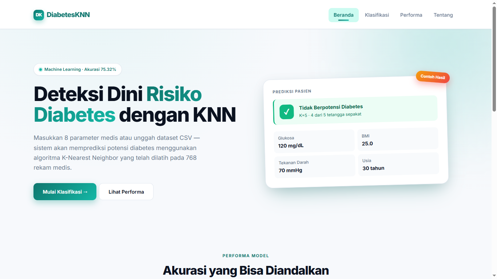
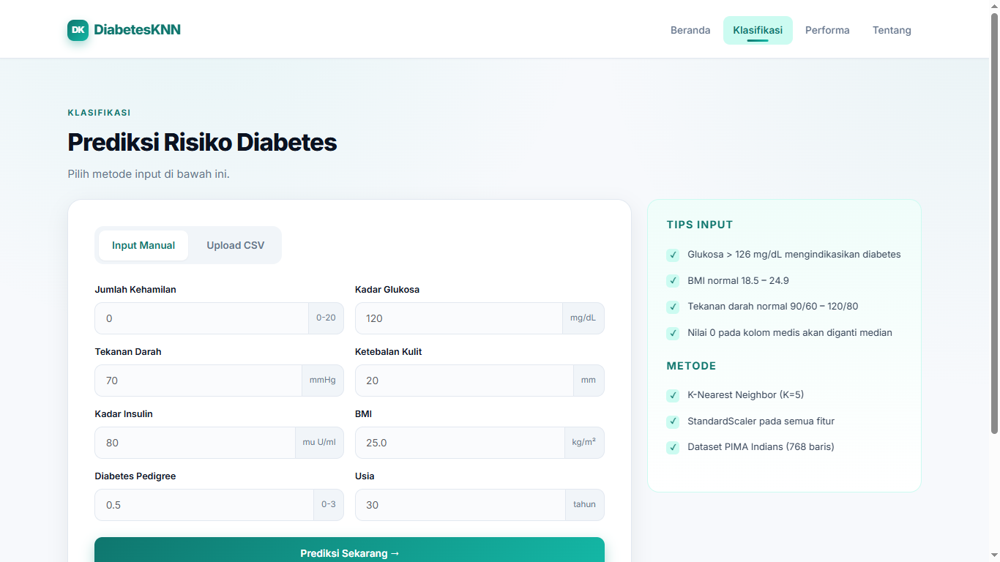
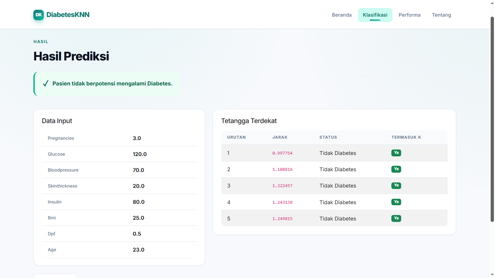
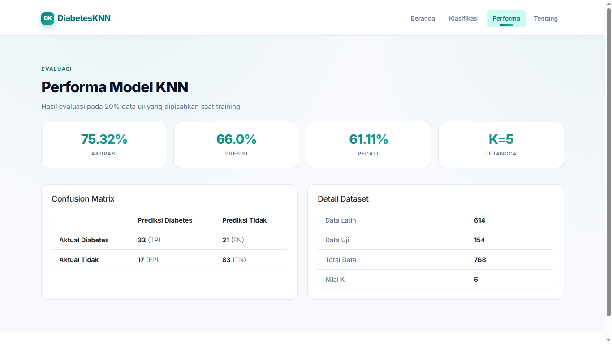

# 🩺 DiabetesKNN — Sistem Klasifikasi Diabetes Berbasis K-Nearest Neighbor

Aplikasi web untuk memprediksi risiko diabetes berdasarkan 8 parameter medis, menggunakan algoritma **K-Nearest Neighbor (KNN)** yang diintegrasikan ke dalam framework **Flask**.

Proyek ini dikembangkan sebagai tugas mata kuliah **Penambangan Data / Machine Learning**, dengan fokus pada penerapan alur machine learning yang benar — mulai dari preprocessing, training, evaluasi, hingga disajikan dalam bentuk aplikasi web.


---

## ✨ Fitur

- **Prediksi Manual** — masukkan 8 parameter medis (glukosa, BMI, insulin, dll.) dan dapatkan hasil prediksi instan.
- **Evaluasi Dataset CSV** — unggah file CSV berisi banyak pasien sekaligus untuk evaluasi batch.
- **Tabel Tetangga Terdekat** — transparansi penuh: lihat data latih yang menjadi "tetangga" dan berkontribusi pada prediksi.
- **Halaman Performa Model** — akurasi, presisi, recall, confusion matrix, dan detail dataset training.
- **Validasi Input** — nilai di luar rentang medis yang wajar akan ditolak dengan pesan jelas.
- **Handling Missing Value** — nilai `0` pada kolom medis (Glucose, BMI, dll.) otomatis diganti median sebelum training.

---

## 🚀 Cara Melihat Aplikasi

Proyek ini dapat dijalankan secara lokal dengan mengikuti langkah pada bagian [Cara Menjalankan](#️-cara-menjalankan).

Setelah aplikasi berjalan, buka browser ke `http://127.0.0.1:5000`.

### Screenshot

| Beranda | Form Klasifikasi |
|---------|------------------|
|  |  |

| Hasil Prediksi | Performa Model |
|----------------|----------------|
|  |  |

> **Catatan**: Buat folder `docs/screenshots/` dan letakkan file `beranda.png`, `form.png`, `hasil.png`, `performa.png` di dalamnya agar gambar muncul di README ini.

---

## 🧠 Tentang Algoritma

**K-Nearest Neighbor (KNN)** adalah algoritma klasifikasi berbasis instance yang memprediksi kelas suatu data baru berdasarkan mayoritas kelas dari *K* tetangga terdekat di ruang fitur.

### Alur Kerja

1. **Standarisasi fitur** dengan `StandardScaler` — agar fitur berskala kecil (BMI ~25) tidak kalah penting dibanding fitur berskala besar (Insulin ~200).
2. **Hitung jarak Euclidean** antara data uji dan seluruh data latih.
3. **Ambil K data latih** dengan jarak terkecil (K=5).
4. **Voting mayoritas** — kelas terbanyak menjadi prediksi.

### Mengapa StandardScaler Penting?

Tanpa scaling, fitur dengan rentang besar (`Insulin`, 0–900) akan mendominasi perhitungan jarak dan membuat `BMI` (0–67) atau `DiabetesPedigreeFunction` (0–2.4) hampir tidak berpengaruh. Ini adalah **kesalahan umum** dalam implementasi KNN.

Pada proyek ini, scaler di-**fit hanya pada data training** (bukan seluruh dataset) untuk mencegah *data leakage*, lalu digunakan kembali untuk transform data test dan data baru.

---

## 📊 Hasil Evaluasi

Model dievaluasi pada **20% data uji** yang dipisahkan dengan stratifikasi kelas (`random_state=42`):

| Metrik | Nilai |
|--------|-------|
| **Akurasi** | 75.32% |
| **Presisi** | 66.00% |
| **Recall** | 61.11% |
| **Data Latih** | 614 baris |
| **Data Uji** | 154 baris |
| **Nilai K** | 5 |

**Confusion Matrix:**

|  | Prediksi Diabetes | Prediksi Tidak |
|--|:-----------------:|:--------------:|
| **Aktual Diabetes** | TP (lihat metrics) | FN |
| **Aktual Tidak** | FP | TN |

> Buka halaman `/metrics` di aplikasi untuk melihat angka confusion matrix terkini.

---

## 📦 Dataset

**[PIMA Indians Diabetes Dataset](https://www.kaggle.com/datasets/uciml/pima-indians-diabetes-database)** — 768 rekam medis wanita keturunan Pima Indian, dengan 8 fitur:

| Fitur | Deskripsi | Rentang Wajar |
|-------|-----------|---------------|
| `Pregnancies` | Jumlah kehamilan | 0–20 |
| `Glucose` | Kadar glukosa plasma | 1–300 mg/dL |
| `BloodPressure` | Tekanan darah diastolik | 1–200 mmHg |
| `SkinThickness` | Ketebalan lipatan kulit trisep | 1–100 mm |
| `Insulin` | Kadar insulin serum 2 jam | 1–900 mu U/ml |
| `BMI` | Body Mass Index | 1–70 kg/m² |
| `DiabetesPedigreeFunction` | Skor riwayat diabetes keluarga | 0–3 |
| `Age` | Usia | 1–120 tahun |
| `Outcome` | Label (1=Diabetes, 0=Tidak) | — |

**Catatan preprocessing**: Kolom `Glucose`, `BloodPressure`, `SkinThickness`, `Insulin`, dan `BMI` memiliki banyak nilai `0` yang **tidak valid secara medis** — nilai tersebut diganti dengan **median kolom** sebelum training.

---

## 🛠️ Tech Stack

**Backend**
- Python 3.10
- Flask 3.0 — web framework
- scikit-learn 1.5 — algoritma KNN & metrik
- pandas 2.2 — manipulasi data
- joblib — serialisasi model

**Frontend**
- Bootstrap 5.3
- Custom CSS (Inter font, gradient teal branding)

**ML Pipeline**
- `StandardScaler` untuk normalisasi fitur
- `train_test_split` dengan stratifikasi kelas
- Evaluasi: akurasi, presisi, recall, confusion matrix

---

## 📁 Struktur Proyek

```text
klasifikasi-diabetes-knn/
├── app/                      # Flask application package
│   ├── __init__.py           # Application factory
│   ├── routes.py             # Semua route
│   └── utils.py              # Validasi form
├── ml/                       # Modul machine learning
│   ├── train.py              # Script training
│   └── predictor.py          # Loader model & fungsi prediksi
├── models/                   # Hasil training (gitignored)
│   ├── knn_model.pkl
│   ├── scaler.pkl
│   └── metrics.json
├── data/
│   └── raw/
│       └── diabetes.csv
├── templates/                # HTML templates
│   ├── base.html
│   ├── index.html
│   ├── form.html
│   ├── hasil.html
│   ├── metrics.html
│   ├── tentang.html
│   └── errors/
├── static/
│   ├── css/
│   │   └── style.css
│   └── img/
│       └── diabetes-illustration.png
├── docs/
│   ├── perhitungan-manual.xlsx
│   └── screenshots/
├── config.py
├── requirements.txt
├── run.py
└── README.md
```

---

## ⚙️ Cara Menjalankan

### 1. Masuk ke folder proyek

```powershell
cd klasifikasi-diabetes-knn
```

Jika proyek belum ada di komputer Anda, salin folder proyek ke direktori lokal terlebih dahulu.

### 2. Buat virtual environment

**Windows:**

```powershell
python -m venv .venv
.venv\Scripts\Activate.ps1
```

**Linux/Mac:**

```bash
python3 -m venv .venv
source .venv/bin/activate
```

### 3. Install dependencies

```bash
pip install -r requirements.txt
```

### 4. Train model (sekali saja)

```bash
python -m ml.train
```

Output yang diharapkan:

```text
Akurasi : 75.32%
Presisi : 66.00%
Recall  : 61.11%

Model, scaler, dan metrik tersimpan di models/
```

### 5. Jalankan aplikasi

```bash
python run.py
```

Buka browser:

http://127.0.0.1:5000

---

## 🧪 Testing Manual

Coba prediksi dengan data contoh:

| Fitur | Nilai |
|---|---:|
| Pregnancies | 2 |
| Glucose | 120 |
| BloodPressure | 70 |
| SkinThickness | 20 |
| Insulin | 80 |
| BMI | 25.0 |
| DiabetesPedigreeFunction | 0.5 |
| Age | 30 |

Hasil yang diharapkan: **Tidak berpotensi diabetes** (kemungkinan besar).

---

## 🎯 Yang Saya Pelajari dari Proyek Ini

- **Data leakage** adalah jebakan nyata — scaler wajib di-fit hanya pada train, bukan seluruh dataset.
- **Handling missing value** sangat mempengaruhi performa KNN; nilai `0` pada kolom medis bukan berarti "nol" tapi "tidak tercatat".
- **Transparansi model** (menampilkan tabel tetangga) meningkatkan kepercayaan pengguna terhadap hasil prediksi.
- **Separation of concerns** — memisahkan logika ML dari route Flask membuat kode lebih mudah di-test dan dikembangkan.

---

## 🔮 Pengembangan Selanjutnya

- [ ] Hyperparameter tuning (grid search untuk nilai K optimal)
- [ ] Bandingkan dengan algoritma lain (Decision Tree, Random Forest, SVM)
- [ ] Simpan riwayat prediksi pengguna (session + database SQLite)
- [ ] Eksplorasi deployment (Railway / Render) di masa mendatang
- [ ] Export hasil prediksi ke PDF

---

## 📄 Lisensi

Proyek ini menggunakan lisensi **MIT** — bebas digunakan untuk pembelajaran.

---

## 👤 Author

**[Nama Anda]**

- GitHub: [@username](https://github.com/username)
- LinkedIn: [linkedin.com/in/username](https://linkedin.com/in/username)
- Email: [email@example.com](mailto:email@example.com)

---

> Proyek ini dibuat untuk keperluan akademik dan portofolio. **Bukan alat diagnosis medis.** Konsultasikan kesehatan Anda dengan dokter.
